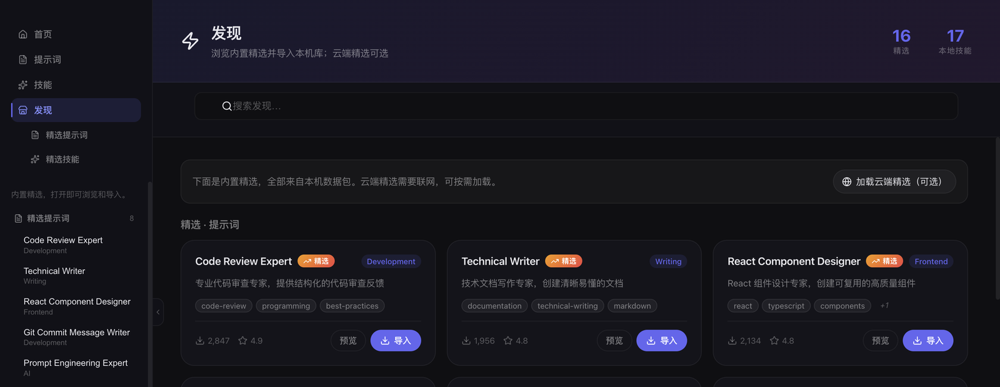
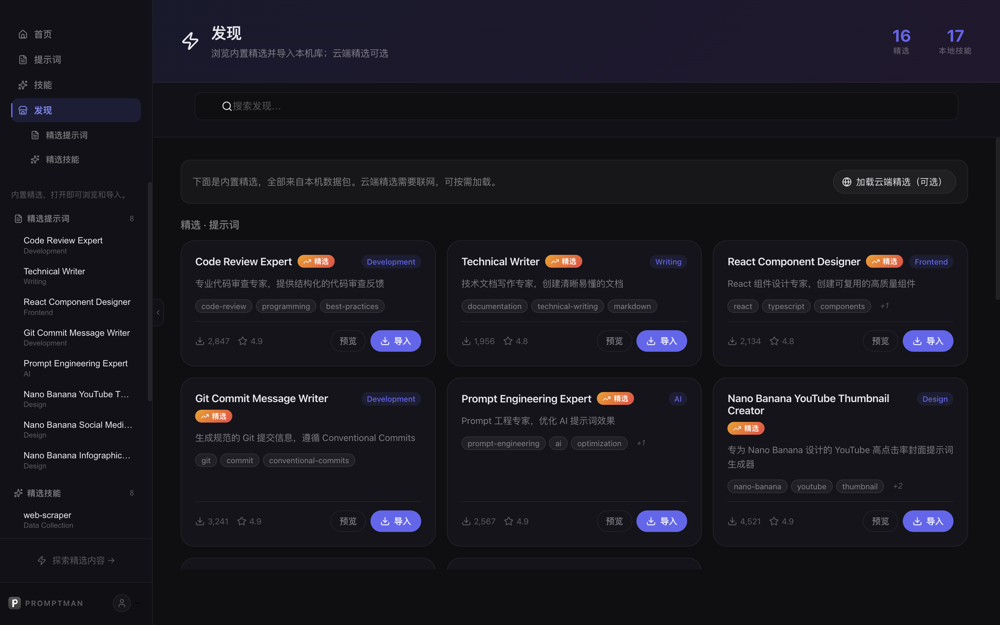

# PromptMan

<p align="center">
  
</p>

<p align="center">
  <strong>A local-first workspace for AI prompts & agent skills</strong><br/>
  <em>Organized libraries · Semantic search · Version history · Prompts that grow into reusable Skills</em>
</p>

<p align="center">
  <a href="https://prompt.solokit.run/"><strong>Download on website</strong></a> ·
  <a href="https://github.com/Alfred-Lau/promptman-community/releases/latest"><strong>GitHub Releases</strong></a> ·
  <a href="#highlights">Highlights</a> ·
  <a href="#download">Download</a> ·
  <a href="#security--privacy">Security & Privacy</a> ·
  <a href="#contributing">Contributing</a>
  &nbsp;|&nbsp;
  <a href="./README.md">中文</a>
</p>

<p align="center">
  <a href="https://prompt.solokit.run/">
    
  </a>
  <a href="https://github.com/Alfred-Lau/promptman-community/releases/latest">
    
  </a>
  <a href="https://github.com/Alfred-Lau/promptman-community/releases">
    
  </a>
  
  <a href="./LICENSE">
    
  </a>
  
</p>

<p align="center">
  <strong>No account required</strong> · <strong>Data stays on your machine</strong> · <strong>Works offline</strong> ·
  If PromptMan helps you, a <strong>⭐ Star</strong> helps others find it ✨
</p>

<p align="center">
  🛡️ <strong>The current open-source release (v0.1.0) is signed & notarized</strong> — macOS installers are Apple Developer ID-signed and Apple-notarized, so Gatekeeper opens them directly. No workarounds needed.
</p>

---

## Why PromptMan?

Once your prompts pile up, the real problem is not storage — it's **finding and using them**:

- 🗂️ **Libraries + tags** — organize prompts into libraries per project/use-case, then filter by tag. No more one giant flat list
- 🔍 **Local semantic search** — find prompts with natural language ("a prompt to write my weekly report"), no keyword guessing. Embeddings run **on-device**, fully offline
- 🕘 **Full version history** — every edit is tracked and rollback-able
- 🧩 **Prompts → Skills in one click** — promote frequently-used prompts into parameterized, reusable Agent Skills, then compose them into SubAgents / Teams
- ⚡ **Global hotkey** — press `Cmd/Ctrl+Shift+P` anywhere to summon the search window
- 🔌 **Browser companion** — a local extension API lets a Chrome extension read from / write to your library while you browse

---

## Preview

<p align="center">
  
</p>

<p align="center">
  
</p>

> More UI captures and a GIF walkthrough live in [`docs/screenshots/`](./docs/screenshots/README.md).

---

## Download

**Preferred**: get the latest build from [prompt.solokit.run](https://prompt.solokit.run/).

Or download from [GitHub Releases](https://github.com/Alfred-Lau/promptman-community/releases/latest):

> ⚡ **The current open-source release (v0.1.0) is a signed & notarized build**: macOS artifacts are Developer ID-signed and Apple-notarized (`spctl` evaluates them as Notarized Developer ID), and Gatekeeper opens them directly — no override steps required.

| Platform | Format | Status |
|----------|--------|--------|
| macOS (Apple Silicon / arm64) | `.dmg` (manual install) / `.zip` (auto-update) | ✅ Available · signed & notarized |
| Windows (x64) | `.exe` (NSIS installer) | ✅ Available · unsigned (SmartScreen will warn — see below) |
| Linux | `.AppImage` / `.deb` | 🚧 Coming Soon |

> **macOS**: since v0.1.0 all official artifacts are Developer ID-signed and Apple-notarized, so Gatekeeper opens them directly — **no** right-click → Open or System Settings → Privacy & Security overrides needed.
> **Windows**: builds are not code-signed yet (no Windows signing certificate). On first run SmartScreen may show "Windows protected your PC" — click **More info → Run anyway**. This is expected behavior.
> **Linux**: installers are still in the works; watch future releases.

**No account needed**: after install you land in your local library; sample prompts and skills are seeded into an empty database.

---

## Highlights

### 📝 Prompt management

- Create and edit templates with title, category, tags
- **Semantic search** in natural language — local embeddings, no network needed
- **Version history** per prompt, rollback anytime
- **Libraries + tags** for two-dimensional organization

### 🧩 Agent Skills / SubAgents / Teams

- Promote prompts into **reusable Skills** (parameters / variables / examples)
- Compose Skills into **Sub-Agents**, orchestrate multiple Sub-Agents as **Agent Teams**
- Everything is versioned — a solid base for standardizing team workflows

### 🛍️ Built-in Discover / Market

- Browse curated prompts and skills, **import with one click**
- Pull skills from GitHub `awesome-skills` and other sources, or install via CLI command

### 🔌 Browser companion (extension API)

- The app serves a local HTTP API (127.0.0.1 only)
- A Chrome extension can search and save prompts / skills from any page (point the extension at your local port)

### ✨ UI & experience

- **Branded boot animation** — an amber typing-logo with an orbit-ring progress animation (BootLoader, pure CSS/SVG with inline styles) renders the moment HTML arrives and fades out once stylesheets are ready, eliminating the flash of unstyled HTML on launch; the Electron splash screen shares the same brand visual
- **Global hotkey** — press `Cmd/Ctrl+Shift+P` anywhere to summon the search window

### ⚙️ Optional capabilities

- **Cloud sync** — the open-source build ships without the official backend; see "Cloud sync" below
- **AI polish / generation** — bring your own key in Settings (OpenAI / Anthropic / DeepSeek / Volcano Ark, etc.)
- **Auto-update** — checks on launch, one-click install

> Auto-updates are distributed through this repository's GitHub Releases; once the repository goes public, updates apply to all installed users.

---

## 🔒 Security & Privacy

- **Data stays on your machine** — prompts and skills live in a local SQLite database and embeddings run on-device; nothing is uploaded to any server by default
- **No telemetry** — no PostHog / Sentry / third-party analytics SDKs, no usage data collected; the launch-time update check only fetches version metadata
- **Works offline** — apart from the one-time ~100 MB embedding-model download on first launch, no network is required
- **macOS: signed & notarized** — since v0.1.0 official artifacts are Developer ID-signed and Apple-notarized (evaluated as Notarized Developer ID); Gatekeeper opens them directly with no security overrides needed
- **Windows: unsigned** — no Windows code-signing certificate yet; SmartScreen may warn ("More info → Run anyway"). Expected behavior
- **Cloud-sync boundary** — see "Cloud sync" below; data can only be synced if you explicitly configure and sign in to a self-hosted compatible backend

---

## ☁️ Cloud sync (open-source build)

- The open-source build ships **without the official cloud-sync backend** — until `PROMPTHUB_API_BASE_URL` points to a real service (by default it is only a placeholder), the sign-in/sync buttons are intentionally non-functional
- All local features (create / search / versions / skill packages / market import) work **fully offline** with no backend
- Developers who want sync can self-host a PromptHub-compatible backend and point the app at it:

  ```bash
  PROMPTHUB_API_BASE_URL=https://your-prompt-hub.example.com pnpm dev
  ```

- The in-app website link (`prompt.solokit.run`) is kept as the project homepage only

---

## Develop

```bash
git clone https://github.com/Alfred-Lau/promptman-community.git
cd promptman-community
corepack enable
pnpm install
pnpm dev
```

Useful commands:

| Command | Purpose |
|---------|---------|
| `pnpm dev` | Full dev environment (Next.js + Electron) |
| `pnpm build` | Production build (Next.js + packaging) |
| `pnpm build:electron:dir` | Electron only, no dmg (fastest verification) |
| `pnpm lint` | ESLint |
| `pnpm type-check` | TypeScript type checking |
| `pnpm clear-cache` | Clear model cache (fixes Protobuf parsing errors) |

> Changes to Electron main-process code (`electron/main/`, `electron/preload/`) require recompilation — run `pnpm dev:watch` or restart `pnpm dev`.

See [CONTRIBUTING.en.md](./CONTRIBUTING.en.md) for details.

---

## FAQ

**Do I need an account?**
No. Open the app and manage local prompts and skills. Sign-in is only for optional cloud sync.

**Slow first launch?**
The ~100 MB embedding model downloads once and is cached afterwards.

**Protobuf parsing failed?**

```bash
pnpm clear-cache
```

**SmartScreen / "unknown publisher" warning on Windows?**
Windows builds are not code-signed yet, so SmartScreen blocks once: click **More info → Run anyway** to install. macOS builds don't have this issue (signed & notarized).

**Where is my data?**

- macOS: `~/Library/Application Support/PromptMan/` or `~/.promptman/` (depending on data-root setting)
- Windows: `%APPDATA%\PromptMan\`
- Linux: `~/.config/PromptMan/`

**Is my data uploaded anywhere?**
No. The default data plane is local SQLite and embeddings run on-device. Sync only happens if you explicitly configure and sign in to a self-hosted backend.

---

## Contributing

Issues and PRs welcome. Please read:

- [CONTRIBUTING.en.md](./CONTRIBUTING.en.md)
- [CODE_OF_CONDUCT.md](./CODE_OF_CONDUCT.md)
- [SECURITY.md](./SECURITY.md)

Good-first-issue labels will be added over time.

---

## Links

| | |
|--|--|
| Website / PromptHub | https://prompt.solokit.run/ |
| Source | https://github.com/Alfred-Lau/promptman-community |
| Releases | https://github.com/Alfred-Lau/promptman-community/releases |

## License

[MIT](./LICENSE) © Solokit Labs
